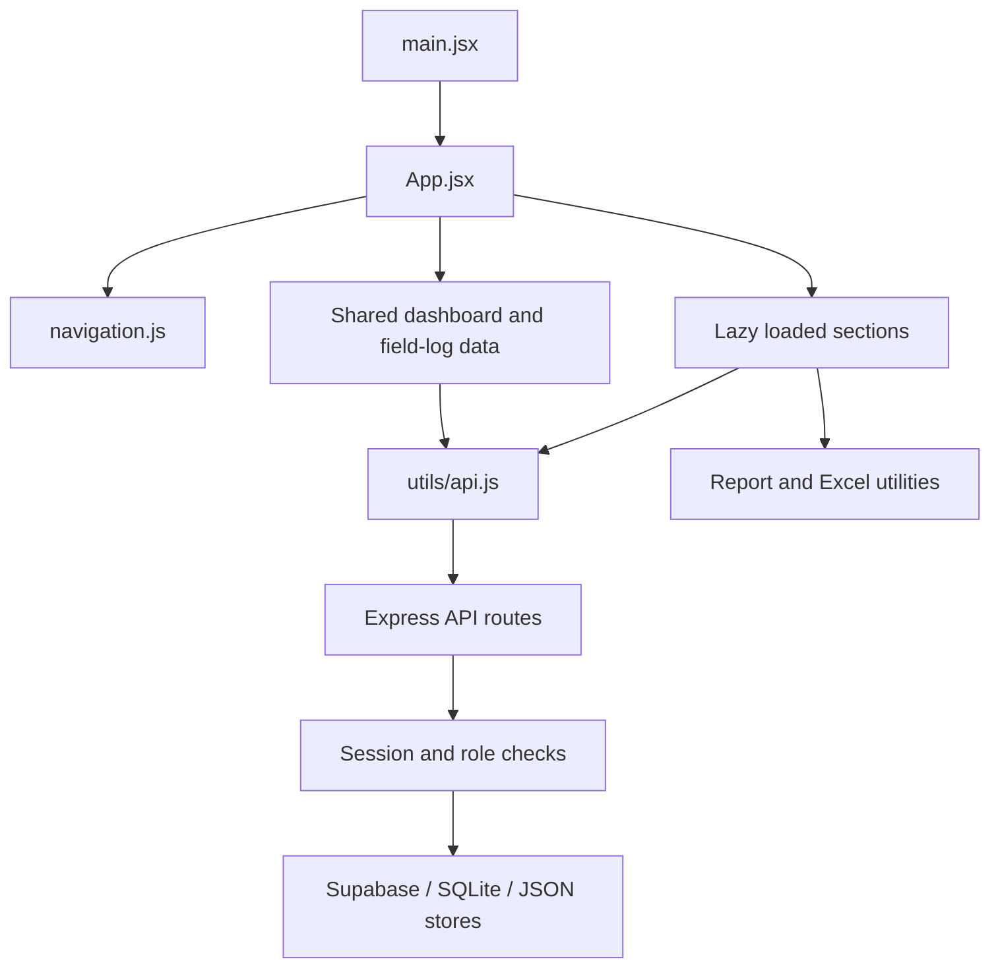

# مرجع فهم المشروع

تحديث بعد المراجعة: نُفذت إصلاحات الحفظ والجلسات والصور في ملفات المشروع. تفاصيل السلوك والترقية والاختبارات في [URGENT_FIXES.md](URGENT_FIXES.md). الوصف أدناه لقطة الفحص الأولية؛ ملاحظات الحفظ الصامت والجلسات والإدراج المكرر تُقرأ مع هذا التحديث.

تاريخ الفحص: 2026-11-03. نسخة Git الحالية وقت الفحص: `01ae414`.

هذا المرجع يصف التطبيق الأساسي من قراءة الكود وتتبع العلاقات والفحوص المحلية. الملاحظات السلوكية المستنتجة من الكود موضحة بصفتها كذلك؛ لم تُختبر العمليات على قاعدة البيانات السحابية، ولم تُفحص الشاشات بصرياً.

## هوية المنتج وحدوده

التطبيق نظام متابعة ميدانية وإدارية ومالية لمشروع تأهيل وصيانة النصب التذكاري للجندي المجهول في بغداد، لشركة رؤية الحداثة للخدمات الهندسية والاستثمار العقاري. بيانات الجهة والمشروع وتواقيع التقارير مركزية في `src/config/org.js`.

التطبيق الأساسي موجود في `src/` و`server/`. توجد مشاريع منفصلة داخل مساحة العمل:

| المجلد | الغرض كما يظهر في ملفاته | علاقته بالتطبيق الأساسي |
| --- | --- | --- |
| `headroom/` | مكتبة وخادم لتحسين وضغط سياق تطبيقات النماذج اللغوية، مع Python وRust وأدوات تكامل | لا توجد إحالات إليه في كود التطبيق أو إعداد البناء والتشغيل الأساسي الذي فُحص |
| `gods-eye-view/` | تطبيق كرة أرضية ثلاثية الأبعاد ومراقبة مصادر بيانات حية، وله حزم وخادم واختبارات مستقلة | مشروع مستقل في مساحة العمل؛ لا يدخل في بناء التطبيق الأساسي |
| `graphify-tool/` | مصدر أداة استخراج واستكشاف الرسم المعرفي | أداة تحليل؛ ليس اعتماداً للتطبيق |
| `graphify-out/` | خريطة معرفة وتقارير تشمل عدة مشاريع ومراجع داخل المساحة | مصدر استكشاف ثانوي؛ قد يحتوي علاقات قديمة أو نتائج تخص المشاريع الأخرى |
| `tokens/`, `components/`, `accessibility/`, `frameworks/`, `taste/`, `workflows/` | مكتبة إرشادات ونظام تصميم وأدوات تحقق | يجب تمييزها عن مكونات التطبيق الفعلية في `src/components/` |
| `design-system/`, `design-systems/` | مواصفات واتجاهات تصميم مرجعية | الوصف المرجعي قد يختلف عن CSS المستخدم فعلياً |

فُحصت هوية المشاريع الجانبية وحدود دمجها؛ لم تُراجع تطبيقاتها الداخلية مراجعة شاملة.

## التقنية والتشغيل

- الواجهة: React، JavaScript وJSX، Vite، CSS مقسّم إلى طبقات، وأيقونات Lucide.
- الخادم: Node.js وExpress مع نمط ES modules.
- البيانات: Supabase عند تهيئته، SQLite محلي، وملفات JSON احتياطية لأقسام محددة.
- تقارير الجداول: مكتبة `xlsx` تُحمّل عند الحاجة.
- التقارير القابلة للطباعة: HTML مع معاينة A4 ثم نافذة طباعة المتصفح وحفظ PDF.
- إعداد النشر: `render.yaml` يبني الواجهة ثم يشغّل خادم Express الذي يخدم `dist/` وواجهات API معاً.
- لا يستخدم التطبيق الأساسي Next.js أو TypeScript أو Tailwind، رغم ورودها في إرشادات نظام التصميم.

| الأمر | الوظيفة |
| --- | --- |
| `npm run dev` | تشغيل الخادم وVite معاً |
| `npm run client` | واجهة التطوير على المنفذ 5180؛ تحويل `/api` إلى المنفذ 5000 |
| `npm run server` | الخادم عبر nodemon |
| `npm run build` | إنتاج ملفات الواجهة في `dist/` |
| `npm start` | تشغيل Express؛ المنفذ من `PORT` أو 5000 |
| `npm run seed` | إعادة تعبئة جداول محلية، ويتضمن حذف بيانات؛ ليس خطوة تشغيل يومية |

المتغيرات الموثقة في `.env.example`: `SUPABASE_URL` و`SUPABASE_KEY` و`AUTH_SECRET` و`ALLOWED_ORIGINS` وبيانات إنشاء المدير الأول. لا تُنقل قيم الأسرار إلى هذا المرجع.

## بنية الواجهة وتدفق الطلب

`src/App.jsx` يدير الجلسة واللغة والثيم والقسم المفتوح. التنقل عبر URL hash دون مكتبة توجيه. أقسام المحتوى تُحمّل باستخدام `React.lazy` و`Suspense`.

`src/navigation.js` هو قائمة الأقسام والمجموعات والمسميات والأدوار المشتركة بين القائمة الجانبية وشريط الهاتف والعناوين. إظهار القسم في الواجهة لا يغني عن تحقق صلاحيات الخادم.

بيانات لوحة التحكم والنزلات وتوزيع المرمر مشتركة في `App.jsx`. بقية الأقسام تجلب بياناتها عند فتحها. `apiFetch` يضيف رمز Bearer ويحوّل الاستجابة 401 إلى خروج من الجلسة. التفضيلات وبيانات الجلسة مخزنة في `localStorage`.

التطبيق يدعم العربية والإنجليزية، ويتبدل اتجاه المستند بين RTL وLTR. الوضع الافتراضي عربي وداكن. الرسائل المنبثقة ومعاينة التقارير لهما مضيفان مركزيان عبر أحداث المتصفح.

## الوحدات الوظيفية

| الوحدة | ملفات الواجهة الرئيسية | البيانات والسلوك |
| --- | --- | --- |
| لوحة المتابعة | `Dashboard.jsx` | الفئات والفقرات والكميات ونسب التقدم، مع أجزاء مشتقة آلياً من النزلات والماربلكس |
| سجل النزلات | `TrackingLogs.jsx` | `sub_units`؛ النزلة والزون والحالة وكميات المرمر الأبيض والجوزي والتواريخ |
| توزيع المرمر | `MaterialsReport.jsx` | `marble_distribution`؛ كميات الأبيض والجوزي وحالة الأعمال حسب الزون |
| تقدم الماربلكس | `MarblexProgress.jsx` | `marblex_progress`؛ القطع وستيلات التثبيت والكميات المنفذة والمتبقية والحالة |
| تقدم الجوينات اليومي | `JointsDaily.jsx` | `joints_daily`؛ يوم العمل والعمال وبنود أفقية وعمودية، مع مجاميع يومية وتراكمية |
| استهلاك وجرد المواد | `MaterialsConsumption.jsx` | `materials_consumption`؛ مواد أساسية، مرمر حسب الزون واللون، عوازل، مواد سائبة، ملاحظات وصور؛ نسخ سجل سابق ومسودة محلية وتنبيهات رصيد |
| أجور العمال | `WorkersWages.jsx` | `workers_wages`؛ الفقرة والطاقم والتاريخ وعدد الشفتات وسعر الشفت والمجموع |
| السلف | `WeeklyAdvance.jsx` | `weekly_advance`؛ نموذج غني داخل حقل `data` يشمل الكميات والأسعار وتقييم الأداء والمواد والدفعات السابقة |
| التحديث اليومي | `DailyUpdates.jsx` | `daily_updates`؛ رسائل وردود وصور وفيديو وصوت، وسجلات نظام تلقائية لبعض التغييرات؛ تحديث بالاستعلام الدوري |
| الملخص التنفيذي | `ExecutiveSummary.jsx` | يجمع بيانات المواد والسلف والأجور مع فلتر زمني؛ رصيد المواد من أحدث جرد ضمن الفترة |
| ملاحظات الاستلام | `components/handover/` | إدخال ومراجعة وتصدير ملاحظات مصورة وسجل استلام الجلي وإعدادات النزلات والمفلترين |
| إدارة الحسابات | `UsersManagement.jsx` | حسابات وأدوار وكلمات مرور؛ متاحة للمدير العام |

صفحة التعريف وتسجيل الدخول في `LandingPage.jsx` و`Login.jsx`. المكونات المشتركة، مثل Modal وField وStatCard وConfirmDialog، في `src/components/ui/`.

## قواعد الحساب المهمة

- تقدم الفقرة ذات الكمية: الكمية المنفذة مقسومة على الإجمالية، مع ضبط الحدود في الخادم.
- بعض فقرات لوحة التحكم مشتقة بالاسم من بيانات النزلات والماربلكس؛ تغيير الاسم يحتاج مراجعة منطق الاشتقاق في `server/index.js`.
- التقدم العام في `/api/dashboard` متوسط حسابي لنسب الفقرات؛ لا توجد أوزان تكلفة أو مدة في هذه المعادلة.
- توجد قيم ثابتة أو افتراضية لبعض مؤشرات لوحة التحكم، ولذلك لا يصح اعتبار جميع بطاقاتها قياسات حية مباشرة.
- أجور العمال: عدد الشفتات مضروباً بسعر الشفت، ويعيد الخادم حساب الإجمالي.
- السلفة: مجموع السعر مضروباً بالكمية، ثم الحصة المحددة في `utils/advance.js` ناقص الدفعات السابقة، مع حقول تجاوز يدوي. الدوال مشتركة مع الملخص التنفيذي.
- الجوينات: إجمالي الصف = العدد مضروباً بالطول، ثم تجميع بحسب النوع والبند والطول. `utils/joints.js` مشترك بين الشاشة والتقرير.
- الماربلكس: نسب منفصلة للقطع والستيل. يلزم الانتباه إلى اختلاف معالجة حالة وجود نوع واحد فقط بين تجميع الواجهة وحساب إنشاء السجل في الخادم.

## المصادقة والصلاحيات

`server/auth.js` يستخدم scrypt لكلمات المرور، ويدعم ترقية كلمة مرور قديمة غير مجزأة عند تسجيل الدخول. الجلسة رمز موقّع بـHMAC-SHA256؛ ليست جلسة Supabase Auth. صلاحية الرمز محددة داخل الملف.

| الدور | المعنى | الصلاحية الأساسية |
| --- | --- | --- |
| `super_admin` | المدير العام | تعديل بيانات المشروع وإدارة الحسابات |
| `admin` | مهندس الموقع | تعديل بيانات المشروع |
| `viewer` | الإدارة العليا | قراءة الأقسام؛ يمكنه إرسال تحديث يومي لأن المسار يتطلب جلسة فقط |

إدارة الاستلام لها صلاحيات إضافية مبنية على قائمة المفلترين، وليست مجرد امتداد مباشر للدور. المدير العام يستطيع تعيين المفلترين، لكنه لا يملك الفلترة تلقائياً ما لم يكن ضمن القائمة.

التحقق الحالي من الجلسة يقرأ الهوية والدور من الرمز الموقّع، ولا يعيد قراءة الحساب من قاعدة البيانات في كل طلب. بالتالي لا يُبطل حذف الحساب أو تغيير دوره الرمز الصادر فوراً. هذه نتيجة قراءة المسار، ولم يُجر اختبار حسابات حية.

## حفظ البيانات والمزامنة

`server/database.js` يفتح `server/project.db`، ويهيئ الجداول عند الاستيراد، ويستورد البيانات السحابية إلى النسخة المحلية عند تفعيل Supabase. بعض الجداول تُمسح محلياً ثم تُعاد تعبئتها من السحابة أثناء التهيئة.

`dbAll` و`dbGet` و`dbRun` ليست ORM عامة: تتعرف على نصوص SQL بعينها وتحوّلها إلى استدعاءات Supabase، وإلا ترجع إلى SQLite. أي استعلام جديد يحتاج مراجعة تغطيته في هذه الطبقة.

سياسات الحفظ تختلف:

- النزلات والفقرات وبعض الرسائل تستخدم طبقة `dbRun` التي قد ترجع للحفظ المحلي إذا فشلت السحابة.
- المواد والأجور والسلف والماربلكس تتضمن مسارات تكتب محلياً وتحدّث ملفات JSON مع محاولة مزامنة سحابية. بعض هذه المحاولات لا تفحص قيمة `error` التي يعيدها Supabase.
- الجوينات ترفض عملية الحفظ إذا أعلنت السحابة النشطة فشلها، ثم تحدّث النسخة المحلية عند النجاح.
- الاستلام يستخدم مخزناً سحابياً حصرياً عند تفعيل Supabase. عند غيابه يستخدم JSON ومجلد صور محليين؛ لا يرجع إلى نسخة JSON عند تعطل السحابة النشطة.

لا توجد طابور مزامنة موحد يعيد إرسال كل التغييرات المحلية لاحقاً، ولذلك الحفظ المحلي الاحتياطي ليس ضماناً لتزامن البيانات بعد عودة الشبكة.

صور الاستلام في bucket خاص مع روابط موقّعة. مرفقات التحديث اليومي تُحفظ في `server/uploads/` وتُعرض عبر مسار ملفات عام، حتى لو كان سجل الرسالة نفسه محفوظاً في Supabase. يجب مراعاة ذلك عند النشر على قرص مؤقت.

ملفات SQL في الجذر تشمل تهيئة الجوينات والسلف والاستلام وإغلاق سياسات الوصول المباشر. نموذج الاستلام يعتمد أيضاً على دالة `handover_next_seq` وعدادات الترقيم. وجود الملفات لا يثبت تنفيذها في السحابة.

## دورة الاستلام

1. إدخال ملاحظة مرتبطة بنزلة ونوع ووصف وصور اختيارية؛ تبدأ `pending`.
2. التعديل والحذف قبل الفلترة لصاحب الملاحظة أو للمفلتر.
3. المفلتر يعتمد أو يؤجل أو يستبعد مع سبب، ويمكنه تعديل الصياغة النهائية.
4. المعتمدة والمؤجلة تحصلان على تسلسلين مستقلين لكل نزلة، مثل `B37-01` و`B37-D01`.
5. يمكن إعادة ملاحظة مفلترة إلى الانتظار. يحافظ النظام على الأرقام السابقة ما لم تُنقل الملاحظة إلى نزلة أخرى.
6. التحديث السحابي مشروط بالحالة المتوقعة لتقليل تعارض قرارات المراجعين المتزامنة.
7. التصدير يُنتج صور JPEG معنونة قابلة للمشاركة أو التنزيل، مع تحويل وضغط الصور في المتصفح.
8. سجل استلام الجلي مستقل بحالات غير مستلمة، مستلمة بملاحظات، ومستلمة، مع تاريخ وملاحظات.

## التقارير والتصميم

`src/utils/report.js` يبني مستندات HTML مشتركة بترويسة الجهة والتواقيع، ويهرب النصوص العادية. `ReportHost.jsx` يعرضها في iframe ويطبعها؛ أجهزة iOS لها مسار فتح مستقل. زر PDF يستخدم إمكانات طباعة المتصفح، ولا يولد ملف PDF في الخادم.

التصدير إلى Excel مركزي في `utils/exportUtils.js`. تصدير صور الاستلام في `utils/handoverImages.js`.

الثيم الفعلي يُستورد من `src/styles/tokens.css` عبر `src/index.css`، ويتبعه base وlayout وcomponents وsections وprint. هذه المتغيرات مختلفة عن ملفات DTCG المرجعية في `tokens/`. فحص ألوان `tokens/` وحده لا يثبت تباين الواجهة الحالية.

يوجد manifest وإعداد إضافة التطبيق للهاتف، لكن لم يوجد تسجيل service worker في مصدر التطبيق الذي فُحص؛ لا يُفترض وجود تشغيل دون اتصال.

## ملاحظات تحتاج متابعة عند التطوير

هذه ملاحظات من الكود، وليست إصلاحات منفذة:

- توحيد سياسة نجاح الحفظ السحابي والمحلي أولوية لتفادي ظهور نجاح محلي لا يبقى بعد إعادة التهيئة من السحابة.
- مسار إرسال التحديث اليومي ينادي `dbRun` الذي يدرج الرسالة في السحابة، ثم ينفذ إدراجاً سحابياً آخر مباشرة. قد ينتج تكرار الرسالة عند نجاح المسارين؛ لم يُختبر على السحابة.
- يعيد هذا المسار قراءة الرسالة من SQLite باستخدام معرف الإدراج السحابي، بينما المرآة المحلية تُدرج بصورة مستقلة؛ يلزم اختبار تطابق المعرفات.
- `site_images` موجودة في نموذج المواد، لكن إنشاء السجل لا يكتبها في SQLite أو payload السحابة، بينما يحتفظ بها JSON المحلي. يلزم تتبع بقائها بعد إعادة الجلب وإعادة التشغيل.
- الجلسات تحتاج آلية إبطال أو إعادة تحقق إذا كان المطلوب تطبيق تغييرات الحسابات والصلاحيات فوراً.
- التهيئة المحلية تبدأ دون انتظار صريح قبل فتح منفذ الخادم، وتوجد ترقية قديمة للأجور تتضمن إسقاط الجدول عند غياب عمود. لا تُشغّل أدوات التهيئة أو seed على بيانات مهمة دون مراجعة.
- تعليمات التصميم والأمثلة ومسارات الفحوص لا تتطابق تماماً مع التطبيق الفعلي، وبعض السكربتات تحتاج تصحيح التعامل مع Windows والترميز.
- README ما زال نص قالب React/Vite. لا يوجد `test` ضمن scripts الحزمة الأساسية، ولم يوجد ملف CI المشار إليه في إرشادات المشروع.

## التحقق المنفذ وحدوده

| الفحص | النتيجة الفعلية |
| --- | --- |
| `npm.cmd run build` | نجح بناء الواجهة |
| `node node_modules/eslint/bin/eslint.js src server` | فشل مع 17 خطأ، كلها في ملفات الخادم |
| `node scripts/accuracy_report.mjs` | أبلغ `17/25 checks passed`؛ لا تُفسر كتصديق فعلي للواجهة |
| `python scripts/validate_tokens.py` | قرأ 14/14 ملف tokens ونجح تحقق JSON والمراجع |
| `python scripts/validate_contrast.py` | نجحت الأزواج الإلزامية للثيم المرجعي؛ توجد تنبيهات للأزواج الاستشارية |
| `python -X utf8 scripts/validate_component_spec.py` | نجح فحص مستندات المكونات المرجعية؛ التشغيل دون UTF-8 تعطل بسبب الترميز |
| `python scripts/validate_theme_refs.py` | فشل لغياب `examples/golden/theme.css` |
| فحوص render وstates بالوضعين وresponsive | تخطتها السكربتات لعدم تثبيت Playwright |

بوابة accuracy تستدعي `python3` غير المتاح في هذه البيئة، وبناء tokens داخلها يتعطل بسبب تحويل file URL إلى مسار Windows غير صحيح. كما أنها تعتبر خروج فحوص المتصفح المتخطاة نجاحاً. مجلد `examples/` الذي تستهدفه فحوص كثيرة غير موجود.

لم تُشغّل اختبارات الخادم التي تستورد قاعدة البيانات وتستدعي التهيئة، ولم تُجر عمليات حفظ أو حذف أو seed أو اتصالات مقصودة ببيانات الإنتاج. لم يُجر اختبار تفاعلي أو فحص بصري للشاشات، ولا تُدّعى مطابقة WCAG للتطبيق الحالي.

## منهج الاستكشاف وحالة العمل

استُخدمت خريطة graphify الموجودة للاستكشاف، ثم تم التحقق من العلاقات المهمة في المصدر الحالي. التقرير القديم يحمل تاريخ 2026-10-27 ونسخة `6e5c111f`، ويشمل مشاريع مستقلة؛ لا ينبغي الاعتماد عليه وحده في أي تعديل.

كانت هناك تغييرات سابقة في `.gitignore` وملفي بيانات الأجور والسلف، وملفات ومجلدات غير متتبعة. لم تُعدّل ملفات التطبيق أو بيانات المستخدم خلال هذا الفحص. أُعيد بناء `dist/`، وأُضيف هذا المرجع مع مخرجات استكشاف graphify المحلية.

عند تغيير أي وحدة، ابدأ بملف واجهتها والمسار المقابل في `server/index.js` أو `server/handover.js`، ثم راجع مخزن البيانات وحسابات التقرير والصلاحيات. عند تغيير التصميم، راجع الثيم الفعلي في `src/styles/tokens.css` قبل المواصفات المرجعية القديمة.
